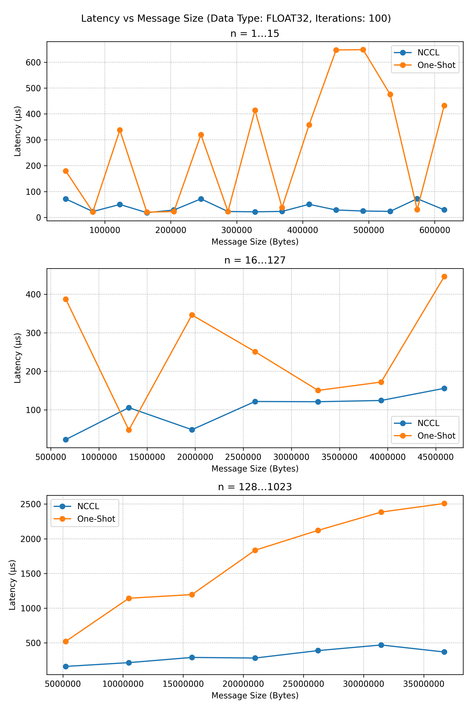
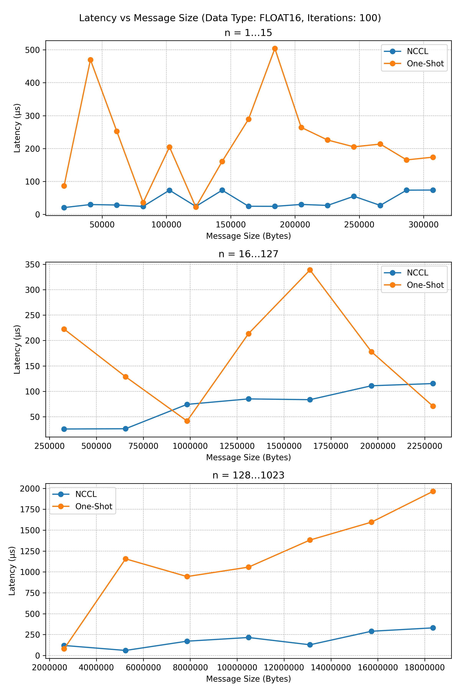

# Custom One-Shot AllReduce

---

This document describes the Custom One-Shot AllReduce implementation provided in `trt_allreduce/src/collectives/allreduce.cu`. The One-Shot strategy packs communication and synchronization into a single collective kernel launch.

## Table of Contents

- [Overview](#overview)
- [Technical Details](#technical-details)
- [Compilation Instructions](#compilation-instructions)
- [Running the Benchmark](#running-the-benchmark)
- [Parameters and Buffers](#parameters-and-buffers)
- [Performance Results](#performance-results)

## Overview

The One-Shot AllReduce uses a single invocation of the customAllReduce runtime to perform reduction across all ranks in one pass. It leverages pre-allocated shared IPC buffers and barrier flags to coordinate peers on a single node.

## Technical Details

**Launcher Call**:

```cpp
// Prepare AllReduce parameters
AllReduceParams p = MakeMultiShotParams(
    d_sendbuff,                // input buffer on device
    d_recvbuff,                // output buffer on device
    elements,                  // number of elements to reduce
    config,                    // benchmark configuration (ranks, dtype, etc.)
    peer_comm_ptrs,            // IPC-shared communication buffers
    peer_barrier_in_ptrs,      // IPC-shared barrier input buffers
    peer_barrier_out_ptrs,     // IPC-shared barrier output buffers
    barrier_counter++          // barrier flag (incremented per call)
);

// Launch one-shot AllReduce kernel
customAllReduce(
    p,
    config.dtype,
    AllReduceStrategyType::ONESHOT,
    static_cast<AllReduceStrategyConfig>(0),
    AllReduceFusionOp::NONE,
    config.stream
);
```

**Parameter explanations**:

- `p`: Struct holding peer pointers, element counts, and barrier flags.
- `config.dtype`: Chooses FP32 (`kFLOAT`) or FP16 (`kHALF`).
- `AllReduceStrategyType::ONESHOT`: Single-kernel reduction strategy.
- `AllReduceStrategyConfig`: Bitmask for optional tuning flags (unused here).
- `AllReduceFusionOp::NONE`: Disables any kernel fusion.
- `config.stream`: CUDA stream on which operations are enqueued.

## Compilation Instructions

To build the One-Shot benchmark target:

```bash
# From workspace root
cd trt_allreduce/scripts/
chmod +x build.sh
./build.sh
```

Ensure MPI, NCCL, and CUDA are available in your environment.

## Running the Benchmark

Run across N ranks (N must match MPI world size and device count):

```bash
cd trt_allreduce/scripts/
chmod +x benchmark.sh
./benchmark.sh -n 8 -d fp32 -i 20
```

Where:

- `-n {N}`: Number of ranks (must match devices).
- `-d {fp32,fp16}`: Select precision.
- `-i`: Number of timed iterations (after 10 warm-up iterations).

Default parameters:

- `-n 8`: Number of ranks (must match devices).
- `-d fp32`: Select precision.
- `-i 1`: Number of timed iterations (after 10 warm-up iterations).

Results are written to `trt_allreduce/data/benchmark_trt_allreduce_<timestamp>_<dtype>.csv`.

## Parameters and Buffers

- **IPC Buffers**: Shared with `cudaIpcGetMemHandle` and `cudaIpcOpenMemHandle` across local ranks.
- **Barrier Flags**: 32-bit counters stored in device memory, exchanged via MPI Allgather before kernel launch.
- **Max Message Size**: Determined by sweep multiplier (`n_mult * 10240 elements`).

## Performance Results

### FP32 AllReduce Results



### FP16 AllReduce Results



Full CSVs for other message sizes and configurations are available under `trt_allreduce/data/`. Use `python/plot_benchmark.py` to generate comprehensive plots.
